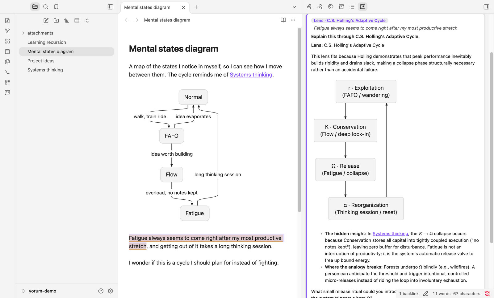
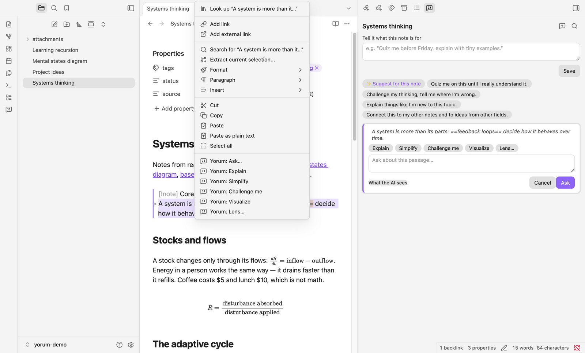
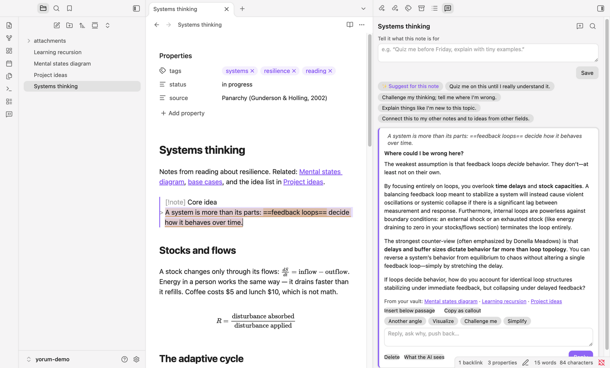
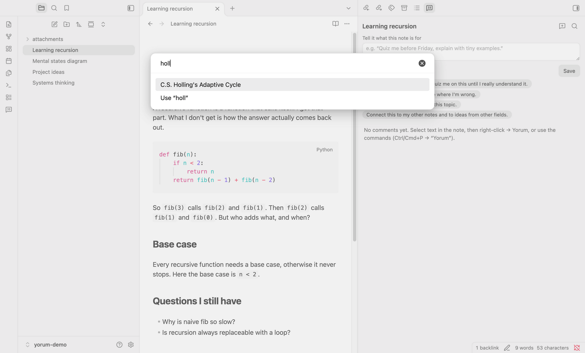
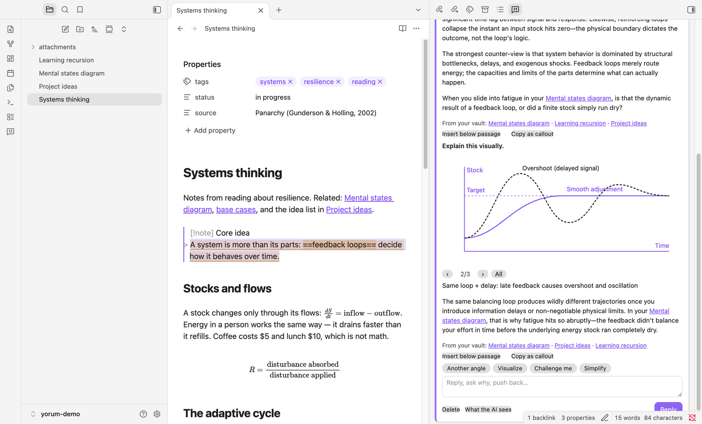
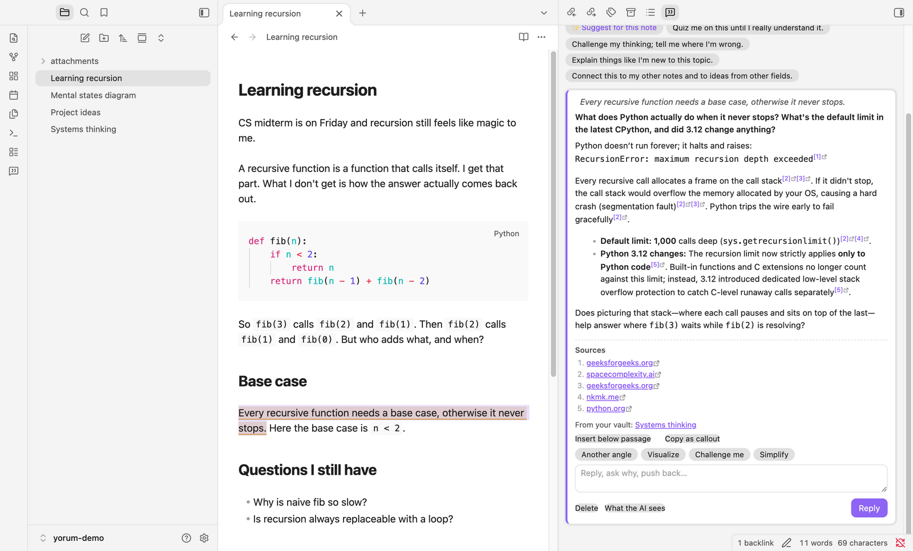
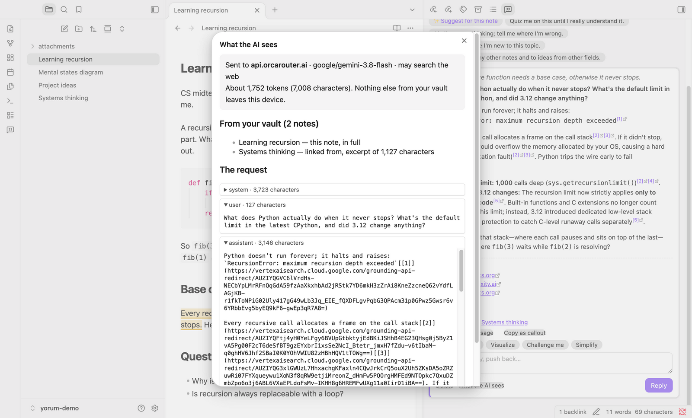
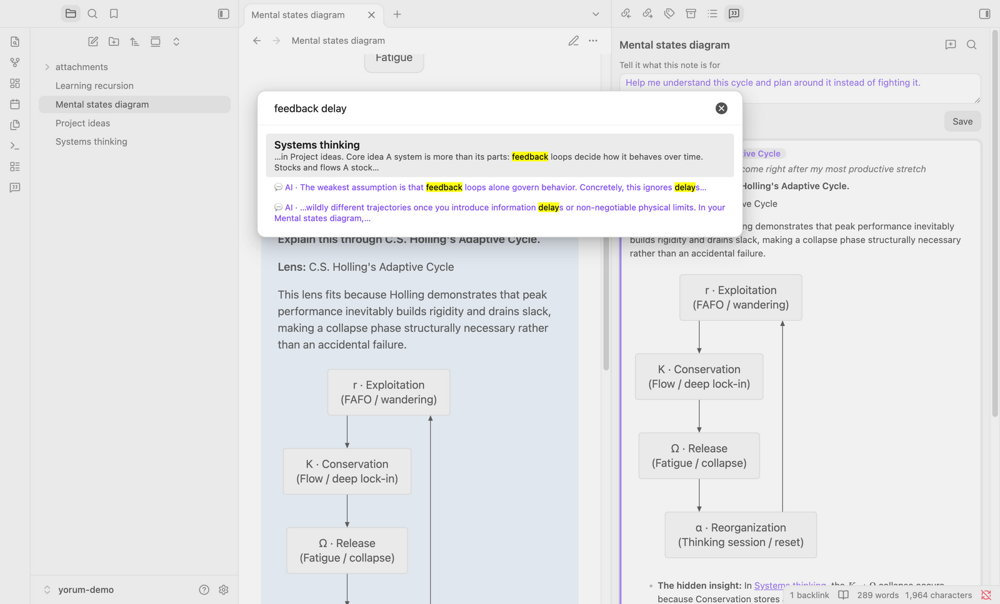
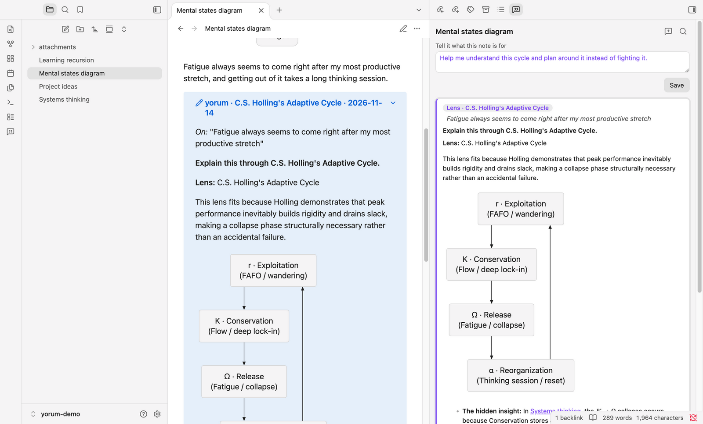
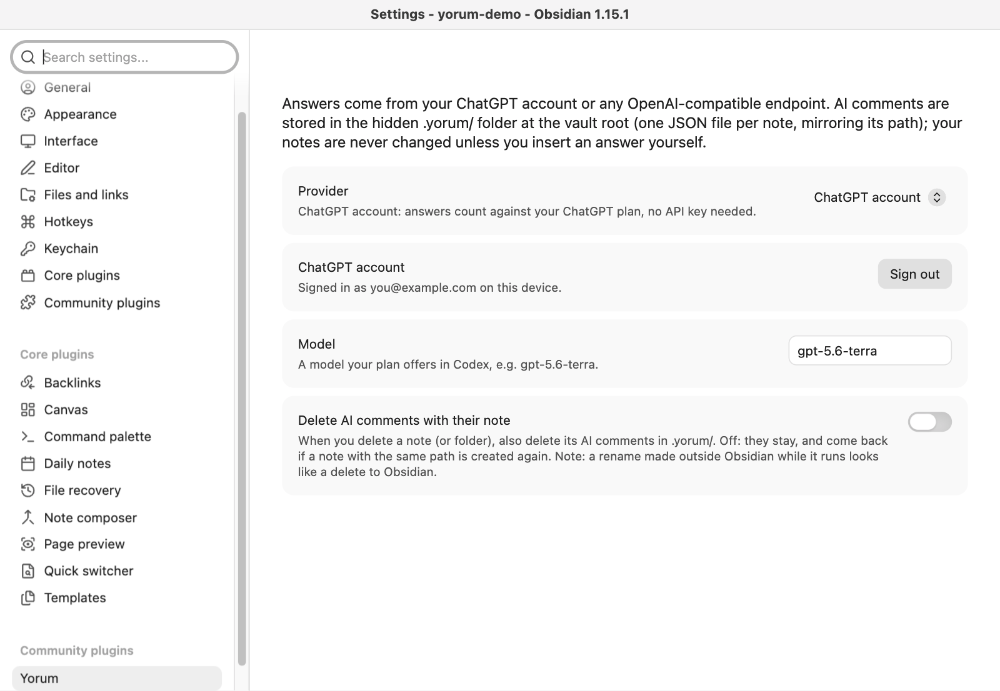

# yorum — talk with your notes

*Yorum* is Turkish for "comment" and "interpretation". It's an AI commentary layer for Markdown notes and Obsidian: you write, and the AI answers in a panel beside your note, pinned to the passage you asked about.



> [!WARNING]
> **This is an MVP, and the codebase was built by an AI coding agent.** A human set the direction, made the product calls and tested it in Obsidian; the code itself was written by the agent. It has a test suite (mocked LLM), but expect rough edges. It is not in Obsidian's community plugin directory. Read the code before trusting it with notes you care about, and keep your vault in git or backed up.

## Two promises

**Read-only.** yorum never writes to your notes. Everything the AI says lives in a hidden `.yorum/` folder at the vault root, one JSON file per note, mirroring its path:

```
vault/
  Study/Recursion.md             ← yours, never written by yorum
  .yorum/Study/Recursion.json    ← intent + comment threads for that note
```

There is one exception, and it's a button: **Insert below passage** copies an answer into your note as a callout when you click it.

**Bring your own key (BYOK) or ChatGPT account.** There is no yorum account, server or telemetry. You point it at any OpenAI-compatible endpoint (OpenAI, OpenRouter, a gateway, a local server) with your own key, or no key for a local server. In Obsidian you can instead sign in with your ChatGPT account, and answers count against your ChatGPT plan. Requests go straight from your device to that endpoint. In Obsidian the key and the ChatGPT sign-in are kept in Obsidian's Keychain on that device, never in the vault. **What the AI sees** shows the exact request before you rely on it.

### Network use and accounts

- **The only remote services are the AI endpoint you configure** (with a ChatGPT account: `chatgpt.com`, plus `auth.openai.com` to sign in and renew the sign-in). yorum sends a request there when you ask something (a question, a quick action, a lens, a suggested intent), and at no other time. The request contains the current note, excerpts of up to four related notes, the passage and the thread. *What the AI sees* shows exactly what goes out.
- **Web search**: with a Gemini model and *Web search* on, the request asks the model to use Google Search. That search happens on the provider's side; yorum itself contacts nothing else.
- **Account and payment**: you need either an API key with an AI provider of your choice (most charge for API use) or, in Obsidian, a ChatGPT plan that includes Codex. A self-hosted OpenAI-compatible server needs no account and no key.
- **No telemetry**, no analytics, no update checks, no yorum server.

## What it does

### Select text, ask about it

Select a passage → right-click → **Ask… · Explain · Simplify · Challenge me · Visualize · Lens…** (the same commands are in the command palette). Commented passages are highlighted in the editor. Click a highlight to open its thread.



### A thinking partner, not a ghostwriter

The AI comments, answers and asks one sharp question back. It never rewrites your note. **Challenge me** goes after your weakest assumption. Related notes from your vault (links, backlinks, similar notes) go into the request, and answers link them as `[[Note]]`.



### Lenses from other fields

**Lens…** explains a passage through a framework from another field: C.S. Holling's Adaptive Cycle, game theory, thermodynamics, and more. **✨ Surprise me** lets the AI pick one. You get a mapping, the insight it reveals, and where the analogy breaks (see the screenshot at the top).



### Visuals

When a picture helps, or you click **Visualize**, answers include a Mermaid diagram or an SVG sketch that builds up step by step. The web app can also draw Vega-Lite charts.



### Web search with sources

With a Gemini model, the AI searches the web when a question needs current facts. It cites inline and lists its sources.



### What the AI sees

Every thread can show the exact request: destination, model, which vault notes were included and how much, and every message.



### Search notes and AI comments

Search across note titles, note text *and* AI comments. Accents are ignored, and Turkish ı matches i.



### Bring an answer home

**Insert below passage** adds an answer to your note as a foldable `[!ai]` callout, with the passage, the question, the answer, its diagram and its sources. **Copy as callout** puts the same text on your clipboard.



### Also

- **Tell it what a note is for**: a per-note instruction in your words ("I'm struggling with recursion, quiz me"), or pick a starter or **✨ Suggest for this note**.
- **Threads**: reply, push back, or use **Another angle · Visualize · Challenge me · Simplify**. Answers stream in. The AI only speaks when asked.
- **Renames and moves follow the note** in Obsidian, including whole folders.
- **Delete AI comments with their note**: optional, off by default.

## Install the Obsidian plugin

```sh
git clone https://github.com/yusufpapurcu/yorum-obsidian-plugin && cd yorum-obsidian-plugin
npm install
npm run plugin:install -- /path/to/your/vault   # builds and copies main.js, manifest.json, styles.css into .obsidian/plugins/yorum/
```

In Obsidian (1.11.4 or newer):

1. Go to Settings → Community plugins and enable **Yorum**.
2. In its settings, pick a provider:
   - **ChatGPT account**: click **Sign in** (your browser opens) or **Use a code** (enter a one-time code on OpenAI's page), then set a model your plan offers in Codex, e.g. `gpt-5.6-terra`.
   - **OpenAI-compatible API**: set the base URL and model, and pick or create the API key secret (optional; leave it empty for a local server).



- **API key**: optional. Kept in Obsidian's Keychain (secret storage) on that device. `data.json` only stores the secret's name, so it is safe to commit. Enter the key once per device.
- **ChatGPT account**: uses the same sign-in as OpenAI's Codex CLI. The sign-in is kept in Obsidian's Keychain on that device (sign in once per device) and renewed automatically; **Sign out** forgets it. Browser sign-in listens on `127.0.0.1:1455` for the redirect (desktop only). Code sign-in works everywhere but must first be turned on in ChatGPT → Settings → Security. Web search isn't offered with a ChatGPT account.
- **Endpoint**: any OpenAI-compatible endpoint works, as long as it allows requests from Obsidian (CORS).
- **Mobile**: untested. The plugin uses Node APIs only on desktop (ChatGPT browser sign-in and requests to `chatgpt.com`, which doesn't allow CORS). On mobile, ChatGPT answers arrive all at once instead of streaming.
- **Panel**: open it from the ribbon icon or "Yorum: Open panel". It follows the active note. Click a diagram to see it full size.

### With obsidian-git

- `.yorum/` is committed, diffed and synced like your notes. Files are pretty-printed JSON, written only when you ask, reply, save an intent or delete a thread. obsidian-git commits hidden folders unless your `.gitignore` excludes them.
- A rename made in Obsidian moves the `.yorum/` file in the same commit, so a pull on another device brings both.
- Obsidian doesn't report changes inside hidden folders. After a pull, new comments appear when you switch notes.

## Local web app

The same core runs as a small local web app on any folder of Markdown files:

```sh
cp .env.example .env   # any OpenAI-compatible endpoint: OPENAI_BASE_URL, OPENAI_MODEL, optional OPENAI_API_KEY
npm install
npm run build
npm start                       # serves ./sample-vault on http://127.0.0.1:4317
npm start -- /path/to/folder    # or VAULT_DIR=...; PORT=... to change the port
```

- **Layout**: three columns: notes, the note rendered like Obsidian, comments.
- **Live sync**: edits made in Obsidian or by a git pull show up live.
- **Open in Obsidian ↗** jumps back to the note when the folder is a registered vault. Set **`OBSIDIAN_CONFIG`** if Obsidian's `obsidian.json` isn't in the default place.
- **Charts**: Vega-Lite charts are drawn here (Obsidian has no chart renderer, so the plugin doesn't offer them to the model).
- **Without `OPENAI_BASE_URL` and `OPENAI_MODEL`** the UI still opens; asking returns an error naming the missing keys. `OPENAI_API_KEY` is optional (local servers).
- **Web search**: with a Gemini model, requests go through the gateway's native Gemini endpoint (`<origin of OPENAI_BASE_URL>/v1beta`; override with `GEMINI_BASE_URL`) with Google Search grounding. `WEB_SEARCH=off` turns it off.

## Known limitations (MVP)

- **Two devices, same note**: commenting on the same note from two devices between syncs can conflict on the sidecar's `updatedAt` line.
- **Renames outside Obsidian**: a rename made outside Obsidian while it runs (Finder, `git mv`) reaches Obsidian as a delete plus a create. The comments stay at the old path; with *Delete AI comments with their note* on, they are deleted.
- **Web app renames**: the web app doesn't track renames.
- **Mobile**: untested.
- **No local-model preset**: a local endpoint works if it speaks the OpenAI API.

## Sidecar format (`.yorum/<note path>.json`)

```json
{
  "version": 1,
  "intent": "I'm struggling with recursion, quiz me",
  "threads": [
    {
      "id": "…",
      "anchor": { "blockIndex": 2, "quote": "how the answer actually comes back out" },
      "createdAt": "…",
      "lens": "C.S. Holling's Adaptive Cycle",
      "messages": [
        { "id": "…", "role": "user", "content": "Explain this visually.", "createdAt": "…", "action": "visualize" },
        { "id": "…", "role": "assistant", "content": "… [\\[1\\]](https://…)", "createdAt": "…",
          "sources": [{ "title": "python.org", "url": "https://docs.python.org/…" }],
          "related": ["Systems thinking.md"] }
      ]
    }
  ],
  "updatedAt": "…"
}
```

**Fields:**
- **`blockIndex`** is the top-level Markdown block of the note body (frontmatter excluded). If the note changes, the quote is found again anywhere in the note. If it's gone, the thread is marked as changed.
- **`anchor: null`** means a note-level thread.
- **Optional fields:** `lens` (the thread's concept lens), `action` (the quick action that sent a user message), `sources` (web search), `related` (vault notes given to the AI for that answer).
- **Old locations**: sidecars from earlier versions (`.margin/…json`, or `<note>.ai.json` next to the note) are moved into `.yorum/` automatically.

Each request sends:
- base instructions
- your intent
- the current note
- related vault notes (excerpts)
- short summaries of the note's other threads
- the anchored passage
- any lens or quick-action instruction
- the thread history

Explain and Simplify use the model's faster thinking level.

## Development

```sh
npm test               # Vitest, mocked LLM
npm run lint           # Obsidian's review rules (eslint-plugin-obsidianmd)
npm run build          # web app (TypeScript → dist/)
npm run plugin:build   # Obsidian plugin → obsidian-plugin/main.js
```

**Releasing the plugin**: set the new `version` in the root `manifest.json` (and its `minAppVersion` if needed), commit, then push a tag with exactly that version, no `v` prefix (`git tag 0.1.1 && git push origin 0.1.1`). The *Release plugin* GitHub Action builds `main.js` and creates the GitHub release with `main.js`, `manifest.json` and `styles.css` attached, which is what Obsidian downloads.

- `src/core/`: framework-free, I/O-free logic shared by the web app and the plugin: the `NoteStore` interface, note parsing, sidecars, vault connections, search, quick actions and lenses, prompt assembly, LLM clients with streaming and Gemini grounding, callout export, and `CommentaryService`.
- `src/node/`: the web app's server side (filesystem store, vault watcher, Obsidian vault lookup). `src/server.ts` and `src/index.ts` hold the HTTP API and the entry point.
- `public/`: the web UI (plain HTML/CSS/JS, no build step).
- `obsidian-plugin/`: the plugin (`NoteStore` on Obsidian's vault API, panel, editor highlights, modals).
- `sample-vault/`: a few demo notes to try it on (the screenshots use them).
- `docs/images/`: README screenshots, taken in Obsidian 1.15.1 with real model answers.
