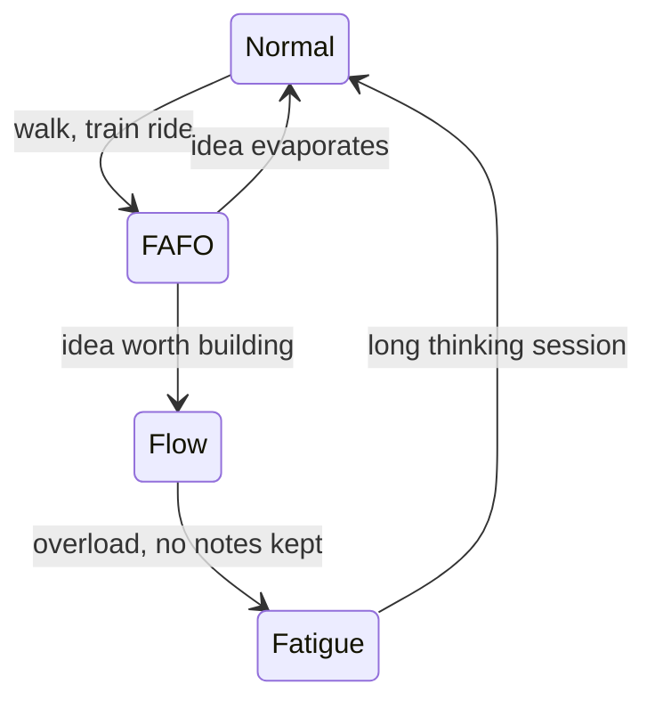

# Mental states diagram

A map of the states I notice in myself, so I can see how I move between them. The cycle reminds me of [[Systems thinking]].

Fatigue always seems to come right after my most productive stretch, and getting out of it takes a long thinking session.

I wonder if this is a cycle I should plan for instead of fighting.
