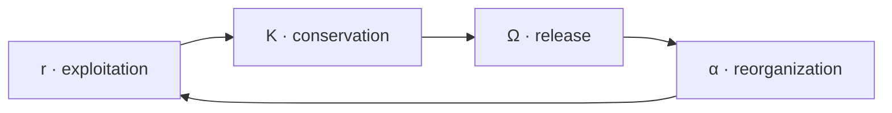

# Systems thinking

Notes from reading about resilience. Related: [[Mental states diagram]], [[Learning recursion#Base case|base cases]], and the idea list in [[Project ideas]].

> [!note] Core idea
> A system is more than its parts: ==feedback loops== decide how it behaves over time.

## Stocks and flows

A stock changes only through its flows: $\frac{dS}{dt} = \text{inflow} - \text{outflow}$. Energy in a person works the same way — it drains faster than it refills. Coffee costs $5 and lunch $10, which is not math.

$$
R = \frac{\text{disturbance absorbed}}{\text{disturbance applied}}
$$

## The adaptive cycle

Holling describes four phases that ecosystems, companies and maybe people cycle through:

> [!warning]- Where the metaphor breaks
> Forests don't choose their phase. People can at least notice which phase they are in.

The system diagram I keep coming back to:

![[cycle.svg|360]]

What I wanted to build with this:

![[Project ideas]]

#systems #todo/read-more
